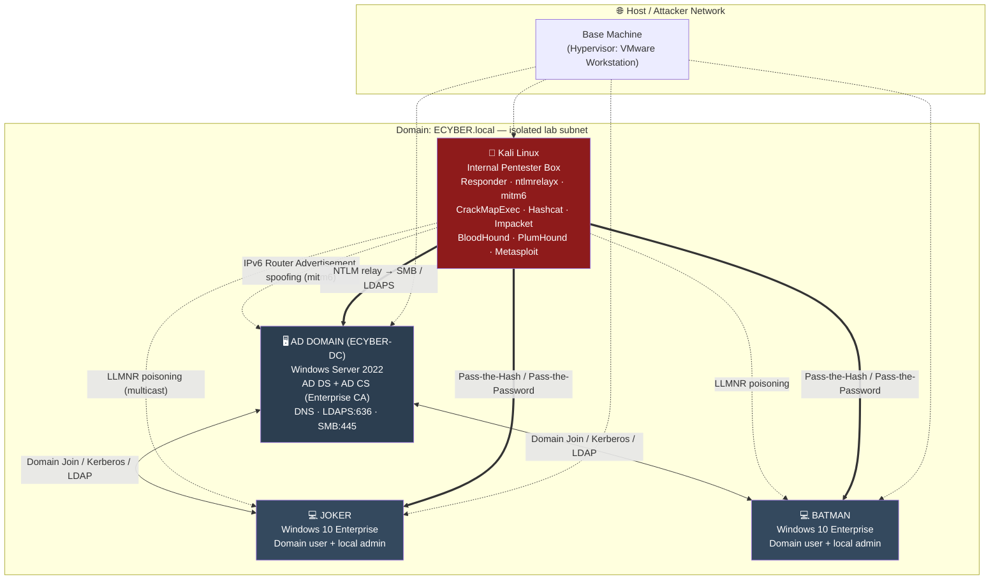
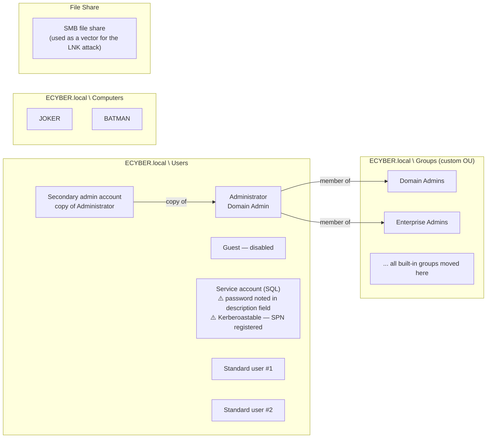
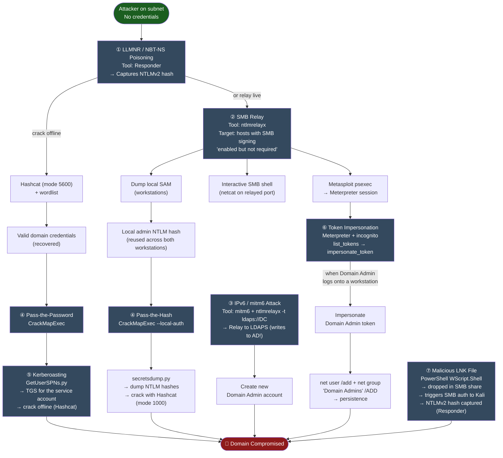

# Active Directory Penetration Testing Lab — ECYBER.local

A fully self-built Active Directory environment used to practice and document real-world AD attack chains, enumeration, and defensive hardening — from initial foothold to domain compromise.

> This lab, its configuration choices, and this write-up were built and documented independently by me as practical work for the "Active Directory Pentest" module of the Cybersecurity Engineering curriculum at EIDIA (course led by Prof. Taha Ait Tchakoucht). The attack techniques themselves are standard, publicly documented AD pentesting methods (Responder, Impacket, BloodHound, etc.) — the implementation, the specific vulnerable configuration, and all commands/results below are my own.

---

## 1. Project Overview

This repository documents a hands-on Active Directory security lab built entirely from scratch in a virtualized environment. The goal was to understand how real AD environments get compromised — by configuring a vulnerable-by-default domain, then attacking it exactly the way an internal penetration tester (or a real attacker with no initial credentials) would.

The project covers the full internal AD pentest lifecycle:

| Phase | What it covers |
|---|---|
| **1. Build** | Stand up a Windows Server 2022 Domain Controller, two Windows 10 Enterprise workstations, and a Kali Linux attack box; create users, groups, GPOs, a file share, and a service account |
| **2. Initial Access** | Exploit unauthenticated network protocols (LLMNR, NBT-NS, IPv6/mitm6) to capture or relay credentials with no starting foothold |
| **3. Enumeration** | Use a compromised low-privilege account to map the domain's users, groups, ACLs, and attack paths |
| **4. Post-Compromise** | Move laterally and escalate privileges using credential reuse, Kerberoasting, token impersonation, and malicious LNK files, ending in full Domain Admin compromise |
| **5. Mitigation** | Apply and document the corresponding defensive controls (GPOs, SMB signing, account tiering, IPv6 firewall rules) for every attack performed |

Every attack in this lab was actually executed against the environment described below (not just theorized), and command outputs were captured at each step (screenshots/logs sanitized before publication — see Section 7).

---

## 2. Architecture

### 2.1 Lab Topology

### 2.2 Domain Objects

### 2.3 Attack Chain (End-to-End)

---

## 3. Lab Build

### 3.1 Infrastructure

- **Hypervisor:** VMware Workstation
- **Domain Controller:** Windows Server 2022, roles installed: **AD DS** (forest `ECYBER.local`) and **AD CS** (Enterprise Root CA, used later for LDAPS)
- **Workstations:** 2× Windows 10 Enterprise (internal hostnames `JOKER`, `BATMAN`), joined to the domain
- **Attacker box:** Kali Linux, same isolated lab subnet
- Static IP + local DNS configured on the DC; workstations point their preferred DNS at the DC

### 3.2 Intentional Misconfigurations (for teaching purposes)

| Misconfiguration | Why it matters |
|---|---|
| Local `Administrator` account enabled on both workstations, with a shared/reused password | Enables Pass-the-Hash / Pass-the-Password lateral movement |
| A standard domain user added as local admin on both workstations | Any compromise of that user's credentials = admin on two hosts |
| A service account's password stored in its AD **description field** | Classic info-disclosure mistake, enumerable via LDAP |
| That same service account has an **SPN** registered via `setspn` | Makes it Kerberoastable |
| SMB signing **enabled but not required** on the workstations (vs "required" on the DC) | Allows NTLM relay to succeed against the workstations |
| No DHCPv6/router-advertisement filtering by default | Allows `mitm6` to hijack name resolution via IPv6 |
| GPO deploying "Turn off Windows Defender" | Lets post-exploitation payloads run unhindered during testing |

---

## 4. Attacks Performed

### 4.1 Initial Access

**LLMNR / NBT-NS Poisoning**
- Tool: `Responder` (`sudo responder -I eth0 -dwPv`)
- Captures NTLMv2-SSP hashes when a workstation fails DNS resolution and falls back to LLMNR
- Cracked offline with Hashcat (`-m 5600`, dictionary attack)

**SMB Relay**
- Checked SMB signing state with `nmap --script=smb2-security-mode.nse`
- Relayed captured NTLM authentication live with `ntlmrelayx.py -tf targets.txt -smb2support`
- Resulted in local SAM dumps, an interactive SMB shell (via `netcat`), and a full Meterpreter session through `exploit/windows/smb/psexec`

**IPv6 DNS Takeover (mitm6)**
- `mitm6` impersonates a DHCPv6/router-advertisement server since IPv6 is enabled by default but unmanaged
- Relayed the resulting NTLM auth to **LDAPS** (`ntlmrelayx.py -6 -t ldaps://...`), which — unlike SMB — allows **writing to Active Directory**
- Result: a new unauthorized account was silently created and added to **Enterprise Admins**

### 4.2 Enumeration

- **Ldapdomaindump** — baseline LDAP/LDAPS dump of users, groups, computers, GPOs
- **BloodHound** (+ Neo4j backend) — graph-based attack-path mapping (`bloodhound-python -c all`), analyzed via pre-built Cypher queries (Domain Admins, DCSync rights, foreign group membership, RDP paths, etc.)
- **PlumHound** — converts raw BloodHound/Neo4j data into human-readable HTML/Excel/Markdown reports
- **PingCastle** — automated AD security health-check against the lab domain, scored across Stale Objects, Trusts, Privileged Accounts, and Anomalies indicators *(exact risk score pending final verification — see note below)*

### 4.3 Post-Compromise

| Technique | Tooling |
|---|---|
| Pass-the-Password | `crackmapexec smb <subnet> -u <user> -p <password>` |
| Pass-the-Hash | `crackmapexec smb <subnet> -u <user> -H <NTLM hash> --local-auth` |
| Credential dumping | `secretsdump.py` (Impacket) + `hashcat -m 1000` |
| Kerberoasting | `GetUserSPNs.py ... -request` against the service account → offline TGS crack |
| Token Impersonation | Meterpreter `incognito` module — `list_tokens -u` / `impersonate_token` to hijack a Domain Admin's delegation token and create a persistent rogue Domain Admin account |
| Malicious LNK file | PowerShell-crafted `.lnk` dropped in the SMB share, triggers outbound SMB auth to the attacker when opened → hash capture via Responder |

---

## 5. Mitigations Documented

For every attack above, a corresponding defensive control was implemented and tested via Group Policy:

- **Disable LLMNR / NBT-NS fallback** (GPO → Administrative Templates → Network → DNS Client)
- **Enforce SMB signing** on all devices (client + server, via Security Options GPO)
- **Account tiering** (Tier 0 / Tier 1 / Tier 2) to prevent high-privilege credentials from touching lower-tier assets
- **Block rogue IPv6 traffic**: inbound/outbound DHCPv6 (UDP 546/547) and inbound ICMPv6 Router Advertisements blocked via Windows Firewall GPO
- **Kerberoasting hardening**: strong service-account passwords, no Domain Admin service accounts, no plaintext passwords in AD object descriptions
- **Token-impersonation hardening**: restrict interactive/network logon for privileged accounts on workstations, sign out (not lock) after privileged sessions, strict account tiering

---

## 6. Tech Stack / Tools Used

`Windows Server 2022` · `Windows 10 Enterprise` · `Kali Linux` · `VMware Workstation` · `Active Directory Domain Services` · `Active Directory Certificate Services` · `Responder` · `Impacket` (`ntlmrelayx`, `secretsdump`, `GetUserSPNs`) · `mitm6` · `CrackMapExec` · `Hashcat` · `Metasploit Framework` (`psexec`, `incognito`) · `BloodHound` + `Neo4j` · `PlumHound` · `PingCastle` · `Nmap` · `Group Policy Management`

---

## 7. Disclaimer & Data Handling

This lab was built entirely within an isolated virtual environment for educational purposes as part of a university cybersecurity curriculum. All attacks were performed exclusively against infrastructure created for this purpose; none of these techniques were used against systems outside this controlled lab.

All credentials, password hashes, and internal IP addresses shown in command examples above are **placeholders**. No real passwords, cracked hashes, or internal network addressing from the lab are published in this repository.

---

## 8. Author

**Asma Daoui** — Cybersecurity Engineering Student, EIDIA (Euromed University of Fes)
[LinkedIn](https://www.linkedin.com/in/asma-daoui-8804b328a/) · [GitHub](https://github.com/BeeHope)
